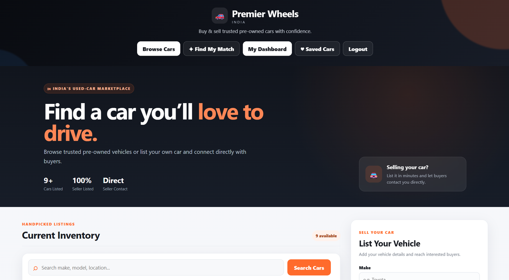
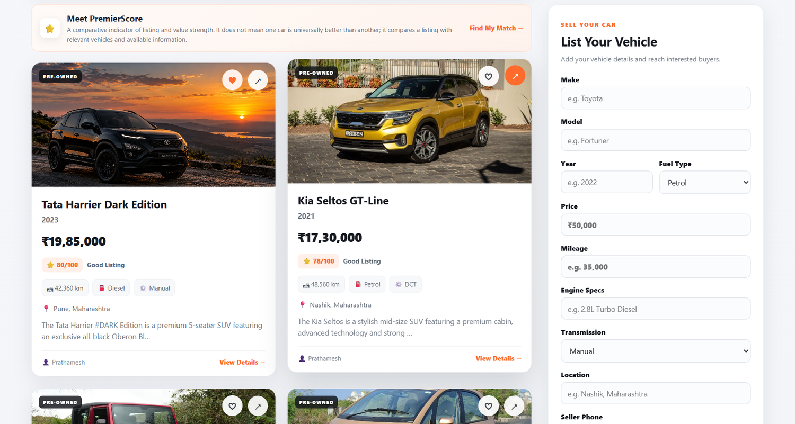
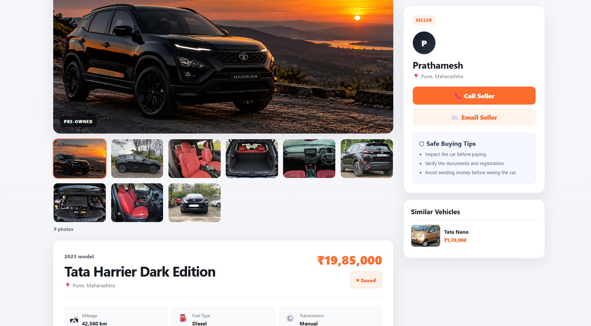
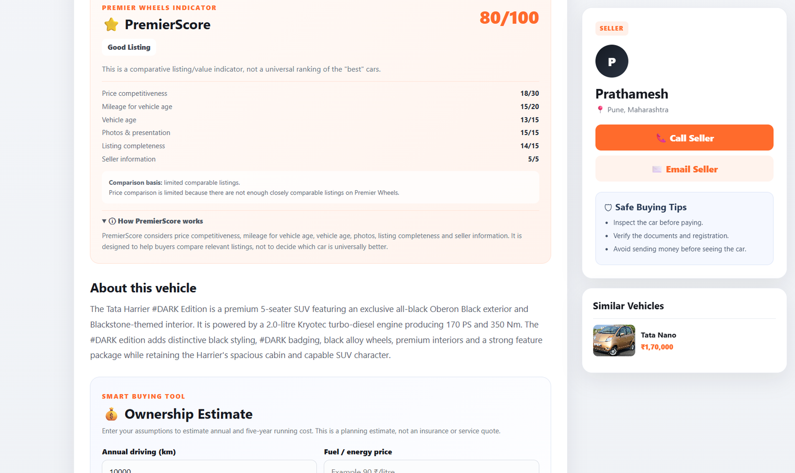
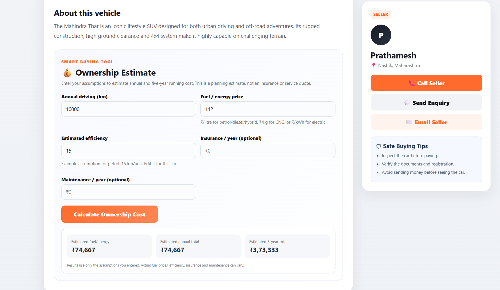
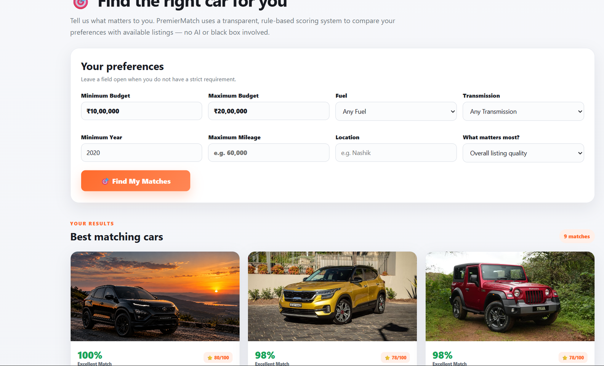
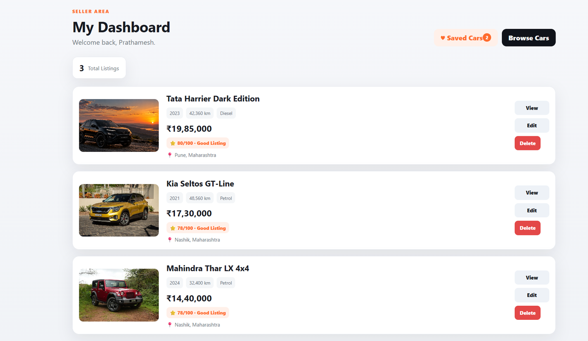
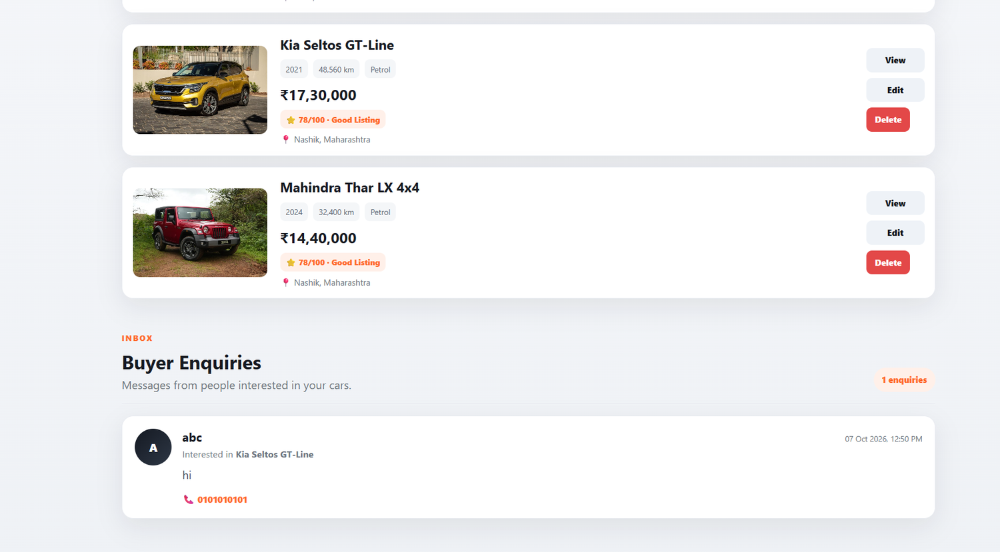
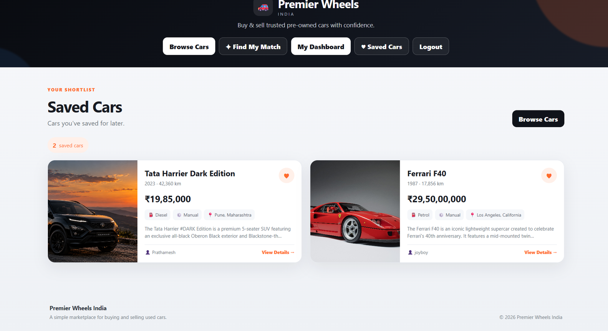

# 🚗 Premier Wheels India

**A full-stack Django marketplace for buying and selling pre-owned vehicles.**

Premier Wheels India is an OLX-style used-car marketplace with vehicle listings, search and filtering, seller dashboards, buyer enquiries, saved cars, and three decision-support tools: PremierScore, PremierMatch, and Ownership Estimate.

The project combines standard marketplace workflows with transparent, rule-based tools that help buyers compare listings and evaluate vehicles against their own preferences and cost assumptions.

## Application Screenshots

<table>
  <tr>
    <td align="center" width="50%"><strong>Homepage & featured listings</strong><br></td>
    <td align="center" width="50%"><strong>Inventory, search & listing form</strong><br></td>
  </tr>
  <tr>
    <td align="center" width="50%"><strong>Vehicle details & photo gallery</strong><br></td>
    <td align="center" width="50%"><strong>PremierScore breakdown</strong><br></td>
  </tr>
  <tr>
    <td align="center" width="50%"><strong>Ownership Estimate</strong><br></td>
    <td align="center" width="50%"><strong>PremierMatch results</strong><br></td>
  </tr>
  <tr>
    <td align="center" width="50%"><strong>Seller dashboard</strong><br></td>
    <td align="center" width="50%"><strong>Buyer enquiries</strong><br></td>
  </tr>
  <tr>
    <td align="center" width="50%"><strong>Saved Cars / Favorites</strong><br></td>
    <td align="center" width="50%"><em>More features are documented below.</em></td>
  </tr>
</table>

## Core Features

### Marketplace
- User registration, login, and logout
- Create, edit, and delete vehicle listings
- Main vehicle images and multi-photo galleries
- Individual vehicle detail pages
- Search by make, model, location, and engine details
- Advanced filters for make, fuel, transmission, year, price, and location
- Sorting by price, mileage, and year
- Seller phone and seller email
- In-app buyer enquiries

### Buyer Tools
- Saved Cars / Favorites
- PremierScore
- PremierMatch
- Ownership Estimate
- Similar vehicles

### Seller Tools
- Seller dashboard and listing management
- Buyer enquiry inbox
- Main image and gallery management
- Seller-specific contact information

## Signature Features

### ⭐ PremierScore

PremierScore is a transparent, rule-based comparative indicator. It is **not** a claim that one vehicle is universally better than another.

| Factor | Maximum points |
|---|---:|
| Price competitiveness | 30 |
| Mileage relative to vehicle age | 20 |
| Vehicle age | 15 |
| Photos and presentation | 15 |
| Listing completeness | 15 |
| Seller information | 5 |
| **Total** | **100** |

The price component prefers same-make/model comparisons and can fall back to similar listings when enough direct comparisons are unavailable. Scores should be interpreted in the context of the available listing information and comparison set.

### 🎯 PremierMatch

PremierMatch compares available listings against a buyer's stated preferences, including:
- Budget
- Fuel type
- Transmission
- Minimum vehicle year
- Maximum mileage
- Location
- Main priority

It returns a percentage match based on transparent rules. The score is **personalized to the buyer**; it is not an objective ranking of the best cars. The same vehicle can receive different match percentages for different buyers.

### 💰 Ownership Estimate

The vehicle detail page includes a client-side running-cost calculator. Buyers can enter assumptions for:
- Annual kilometres
- Fuel or energy price
- Estimated vehicle efficiency
- Annual insurance
- Annual maintenance

The calculator estimates annual and five-year running costs. Results depend on the assumptions entered and are not an exact ownership quotation, insurance quote, or service quote.

## Tech Stack

- **Language:** Python 3.11
- **Backend:** Django 5.2
- **Database:** SQLite for local development
- **Frontend:** HTML5, CSS3, JavaScript
- **Image handling:** Pillow
- **Testing:** Django test framework

## Application Structure

```text
Premier-Wheels-India/
├── Cars/
│   ├── settings.py
│   ├── urls.py
│   ├── asgi.py
│   └── wsgi.py
├── vehicles/
│   ├── models.py
│   ├── forms.py
│   ├── views.py
│   ├── scoring.py
│   ├── urls.py
│   ├── admin.py
│   ├── tests.py
│   ├── migrations/
│   ├── templates/vehicles/
│   ├── static/vehicles/
│   └── templatetags/
├── docs/
│   └── screenshots/
├── manage.py
├── requirements.txt
├── PREMIER_FEATURES.md
└── README.md
```

## Database Models

The application uses Django ORM relationships for:
- `Vehicle` — vehicle listing details and seller ownership
- `VehiclePhoto` — additional photos linked to a vehicle
- `Enquiry` — buyer messages associated with a vehicle and seller
- `Favorite` — saved vehicle relationships for users

Vehicles are linked to Django's built-in `User` model so ownership and seller-side actions can be associated with authenticated accounts.

## Local Setup

### 1. Clone the repository

```bash
git clone https://github.com/Prathamesh-199/Premier-Wheels-India.git
cd Premier-Wheels-India
```

### 2. Create a virtual environment

Windows PowerShell:

```powershell
python -m venv .venv
.\.venv\Scripts\Activate.ps1
```

### 3. Install dependencies

```powershell
python -m pip install -r requirements.txt
```

### 4. Apply database migrations

```powershell
python manage.py migrate
```

### 5. Run the system checks

```powershell
python manage.py check
```

Expected output:

```text
System check identified no issues (0 silenced).
```

### 6. Run the automated tests

```powershell
python manage.py test
```

The current test suite contains seven tests covering price/mileage form input, seller phone validation, vehicle year validation, enquiry phone validation, PremierMatch budget validation, and score range/notice behavior.

### 7. Start the development server

```powershell
python manage.py runserver 8080
```

Open <http://127.0.0.1:8080/> in your browser.

> The database and uploaded media are local runtime data and are intentionally excluded from this repository. To explore the application, register a new account and add sample vehicle listings.

## Environment Variables

For deployment, configure these environment variables:

- `DJANGO_SECRET_KEY`
- `DJANGO_DEBUG`
- `DJANGO_ALLOWED_HOSTS`

Do not commit real secrets, passwords, private user data, or production credentials to GitHub. The repository is intended as a portfolio/development project; use production-grade configuration before deploying publicly.

## Security & Validation

The project uses Django authentication, CSRF protection, form validation, seller ownership checks, and validation for vehicle year, seller phone, and matching-budget inputs. Production deployment still requires appropriate settings, secure secret management, HTTPS, production database and media storage, and a production WSGI/ASGI server.

## Resume Description

**Premier Wheels India — Django Full-Stack Used-Car Marketplace**  
*Python, Django, SQLite, HTML, CSS, JavaScript, Pillow*

Developed a full-stack used-car marketplace with authentication, vehicle CRUD, advanced search and filtering, multi-image galleries, seller contact, buyer enquiries, favorites, and a seller dashboard. Implemented a transparent rule-based listing indicator (PremierScore), personalized preference matching (PremierMatch), and an interactive ownership-cost estimator.

## Interview Talking Points

1. Django MVT architecture and URL/view/template separation.
2. Django ORM relationships between users, vehicles, photos, enquiries, and favorites.
3. Authentication and seller ownership enforcement for listing actions.
4. Multi-image gallery handling with a separate photo model.
5. How PremierScore differs from personalized PremierMatch.
6. Why the ownership estimator is assumption-based rather than a guaranteed quote.
7. Form validation and automated tests.

## Production Readiness Notes

Before production deployment:
- Set a strong `DJANGO_SECRET_KEY` through the environment.
- Set `DJANGO_DEBUG=False` and configure `DJANGO_ALLOWED_HOSTS`.
- Use a production database such as PostgreSQL.
- Configure proper static and media storage.
- Serve the application with a production WSGI/ASGI server behind HTTPS.
- Add production logging, monitoring, backups, and deployment-specific security settings.

## License

No open-source license has been added yet. Unless a license is added, normal copyright restrictions apply; contact the repository owner for reuse permission.
